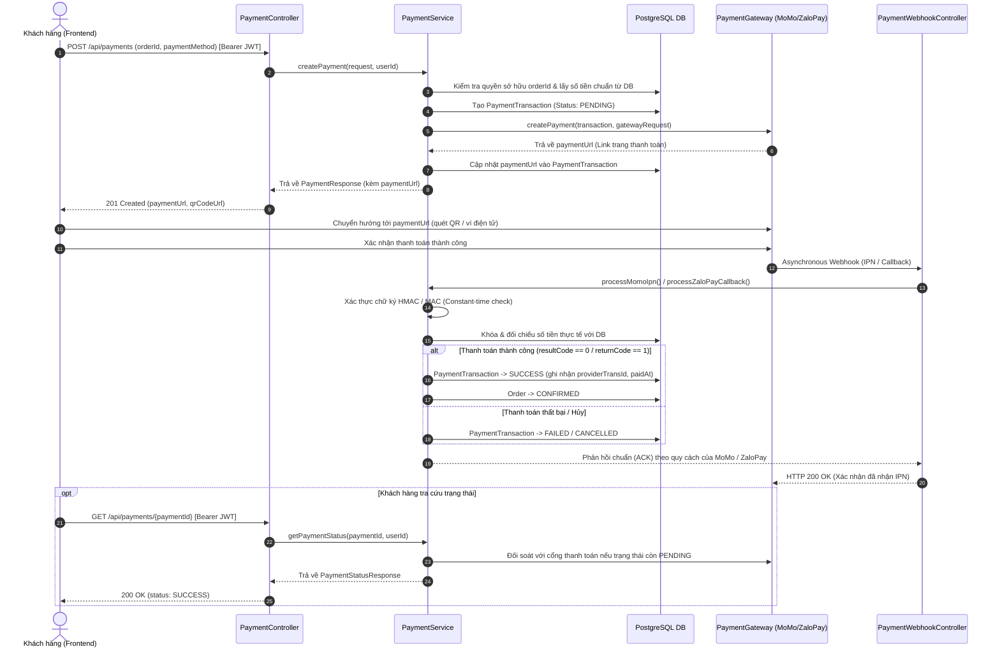

# 📖 Tài Liệu Hướng Dẫn Tích Hợp & Kiểm Thử Cổng Thanh Toán (MoMo & ZaloPay) — Memento3D Backend

> **Tài liệu chuẩn dành cho Developer & QA**: Hướng dẫn chi tiết kiến trúc, cấu hình môi trường, đặc tả API, kịch bản test tự động, test thủ công qua Postman/Swagger, và test Webhook local với Ngrok/Cloudflare Tunnel.

---

## 📑 Mục Lục
1. [Tổng Quan Kiến Trúc Thanh Toán](#1-tổng-quan-kiến-trúc-thanh-toán)
2. [Cấu Hình Môi Trường & API Keys](#2-cấu-hình-môi-trường--api-keys)
3. [Đặc Tả API Endpoints](#3-đặc-tả-api-endpoints)
4. [Hướng Dẫn Kiểm Thử Tự Động (Automated Tests)](#4-hướng-dẫn-kiểm-thử-tự-động-automated-tests)
5. [Hướng Dẫn Kiểm Thử Qua Swagger UI & Postman](#5-hướng-dẫn-kiểm-thử-qua-swagger-ui--postman)
6. [Hướng Dẫn Kiểm Thử Webhook Local (Ngrok / Cloudflare Tunnel)](#6-hướng-dẫn-kiểm-thử-webhook-local-ngrok--cloudflare-tunnel)
7. [Giả Lập Webhook Bằng cURL (Mock IPN / Callback)](#7-giả-lập-webhook-bằng-curl-mock-ipn--callback)
8. [Các Cơ Chế Bảo Mật & Xử Lý Ngoại Lệ](#8-các-cơ-chế-bảo-mật--xử-lý-ngoại-lệ)
9. [Troubleshooting & FAQ](#9-troubleshooting--faq)

---

## 1. Tổng Quan Kiến Trúc Thanh Toán

Hệ thống thanh toán của Memento3D Backend được xây dựng theo mô hình **Package-by-Feature** kết hợp các Design Pattern chuẩn doanh nghiệp:
- **Strategy Pattern (`PaymentGateway`)**: Chuẩn hóa hành vi tạo thanh toán (`createPayment`) và truy vấn trạng thái (`queryPayment`).
- **Factory Pattern (`PaymentGatewayFactory`)**: Tự động nhận diện và phân giải gateway tương ứng (`MOMO`, `ZALOPAY`) dựa trên dependency injection của Spring Boot.
- **Idempotent Webhook Handler**: Đảm bảo an toàn khi nhận trùng lặp callback từ đối tác, không thực hiện đơn hàng (fulfillment) hai lần.
- **Constant-Time Signature Verification**: Dùng `MessageDigest.isEqual()` để chống tấn công Timing Attack khi đối chiếu HMAC-SHA256.
- **Optimistic Locking (`@Version`)**: Bảo vệ entity `PaymentTransaction` và `Order` khi có nhiều luồng hoặc webhook đồng thời cập nhật.

### 🔄 Sơ Đồ Luồng Hoạt Động (Data Flow)



---

## 2. Cấu Hình Môi Trường & API Keys

### 2.1. File cấu hình `.env` hoặc Biến môi trường hệ thống

Dự án cung cấp cấu hình sẵn sàng cho môi trường **Sandbox/Test** của MoMo và ZaloPay trong file `.env`:

```env
# =====================================================================
# MOMO PAYMENT GATEWAY (SANDBOX)
# =====================================================================
MOMO_PARTNER_CODE=MOMO
MOMO_ACCESS_KEY=F8BBA842ECF85
MOMO_SECRET_KEY=K951B6PE1wa8ngfBW/gahOD0viQDuMmq
MOMO_ENDPOINT=https://test-payment.momo.vn/v2/gateway/api/create
MOMO_QUERY_ENDPOINT=https://test-payment.momo.vn/v2/gateway/api/query
MOMO_REDIRECT_URL=http://localhost:3000/payment/result
MOMO_IPN_URL=http://localhost:8080/api/payments/webhooks/momo

# =====================================================================
# ZALOPAY PAYMENT GATEWAY (SANDBOX)
# =====================================================================
ZALOPAY_APP_ID=2553
ZALOPAY_KEY1=PcY4iZIKFCIdgZvA6ueMcMHHUbRLYjPL
ZALOPAY_KEY2=kLtgPl8HHhfvMuD2wKfgccM4nwqiEdtF
ZALOPAY_ENDPOINT=https://sb-openapi.zalopay.vn/v2/create
ZALOPAY_QUERY_ENDPOINT=https://sb-openapi.zalopay.vn/v2/query
ZALOPAY_CALLBACK_URL=http://localhost:8080/api/payments/webhooks/zalopay
ZALOPAY_REDIRECT_URL=http://localhost:3000/payment/result
```

### 2.2. Ánh xạ trong `application.yml`

```yaml
app:
  payment:
    momo:
      partner-code: ${MOMO_PARTNER_CODE:MOMO}
      access-key: ${MOMO_ACCESS_KEY:F8BBA842ECF85}
      secret-key: ${MOMO_SECRET_KEY:K951B6PE1wa8ngfBW/gahOD0viQDuMmq}
      endpoint: ${MOMO_ENDPOINT:https://test-payment.momo.vn/v2/gateway/api/create}
      query-endpoint: ${MOMO_QUERY_ENDPOINT:https://test-payment.momo.vn/v2/gateway/api/query}
      redirect-url: ${MOMO_REDIRECT_URL:http://localhost:3000/payment/result}
      ipn-url: ${MOMO_IPN_URL:http://localhost:8080/api/payments/webhooks/momo}
      request-type: ${MOMO_REQUEST_TYPE:captureWallet}
      timeout-seconds: ${MOMO_TIMEOUT_SECONDS:30}
    zalopay:
      app-id: ${ZALOPAY_APP_ID:2553}
      key1: ${ZALOPAY_KEY1:PcY4iZIKFCIdgZvA6ueMcMHHUbRLYjPL}
      key2: ${ZALOPAY_KEY2:kLtgPl8HHhfvMuD2wKfgccM4nwqiEdtF}
      endpoint: ${ZALOPAY_ENDPOINT:https://sb-openapi.zalopay.vn/v2/create}
      query-endpoint: ${ZALOPAY_QUERY_ENDPOINT:https://sb-openapi.zalopay.vn/v2/query}
      callback-url: ${ZALOPAY_CALLBACK_URL:http://localhost:8080/api/payments/webhooks/zalopay}
      redirect-url: ${ZALOPAY_REDIRECT_URL:http://localhost:3000/payment/result}
      timeout-seconds: ${ZALOPAY_TIMEOUT_SECONDS:30}
```

---

## 3. Đặc Tả API Endpoints

### 3.1. Khởi tạo thanh toán (`POST /api/payments`)
- **Mục đích**: Bắt đầu phiên thanh toán cho đơn hàng in 3D.
- **Yêu cầu bảo mật**: `Authorization: Bearer <JWT_ACCESS_TOKEN>`
- **Request Body**:
```json
{
  "orderId": "3fa85f64-5717-4562-b3fc-2c963f66afa6",
  "paymentMethod": "MOMO",
  "orderInfo": "Thanh toán đơn hàng in 3D tượng chân dung",
  "redirectUrl": "http://localhost:3000/payment/result"
}
```
*Lưu ý*: `paymentMethod` nhận `MOMO` hoặc `ZALOPAY`.

- **Response thành công (HTTP 201 Created)**:
```json
{
  "paymentId": "7e3b978d-192e-4b2a-89aa-56a8fa008899",
  "orderId": "3fa85f64-5717-4562-b3fc-2c963f66afa6",
  "paymentMethod": "MOMO",
  "status": "PENDING",
  "amount": 150000.00,
  "currency": "VND",
  "paymentUrl": "https://test-payment.momo.vn/v2/gateway/pay?s=...",
  "qrCodeUrl": "https://test-payment.momo.vn/qr/...",
  "deeplink": null,
  "merchantTransactionId": "MM_1728830123456_837482",
  "createdAt": "2026-10-13T14:15:20.123Z"
}
```

---

### 3.2. Tra cứu trạng thái thanh toán (`GET /api/payments/{paymentId}`)
- **Mục đích**: Lấy thông tin chi tiết và trạng thái của giao dịch. Tự động truy vấn (reconcile) với cổng thanh toán nếu giao dịch vẫn đang ở trạng thái `PENDING`.
- **Yêu cầu bảo mật**: `Authorization: Bearer <JWT_ACCESS_TOKEN>` (Chỉ chính chủ đơn hàng hoặc `ROLE_ADMIN` được quyền xem).
- **Response thành công (HTTP 200 OK)**:
```json
{
  "paymentId": "7e3b978d-192e-4b2a-89aa-56a8fa008899",
  "orderId": "3fa85f64-5717-4562-b3fc-2c963f66afa6",
  "paymentMethod": "MOMO",
  "status": "SUCCESS",
  "amount": 150000.00,
  "currency": "VND",
  "merchantTransactionId": "MM_1728830123456_837482",
  "providerTransactionId": "3192847592",
  "failureCode": null,
  "failureMessage": null,
  "paidAt": "2026-10-13T14:16:05.890Z",
  "createdAt": "2026-10-13T14:15:20.123Z",
  "updatedAt": "2026-10-13T14:16:05.901Z"
}
```

---

### 3.3. Webhook MoMo IPN (`POST /api/payments/webhooks/momo`)
- **Mục đích**: Nhận thông báo bất đồng bộ từ MoMo sau khi khách hàng hoàn tất giao dịch.
- **Yêu cầu bảo mật**: **Public Endpoint** (Đã mở trong `SecurityConfig`), xác thực bằng **chữ ký HMAC-SHA256**.
- **Request Body (Từ MoMo Gateway gửi đến)**:
```json
{
  "partnerCode": "MOMO",
  "orderId": "MM_1728830123456_837482",
  "requestId": "9a7f34be-9011-477f-a63b-18a7c1a89091",
  "amount": 150000,
  "orderInfo": "Thanh toán đơn hàng in 3D tượng chân dung",
  "orderType": "momo_wallet",
  "transId": 3192847592,
  "resultCode": 0,
  "message": "Successful.",
  "payType": "qr",
  "responseTime": 1728830165890,
  "extraData": "",
  "signature": "3c8479b183660fa1107f9038e88e2118dbd809ff4ee141d8eeb3b603ebad92f4"
}
```
- **Response trả về cho MoMo (HTTP 200 OK)**:
```json
{
  "partnerCode": "MOMO",
  "orderId": "MM_1728830123456_837482",
  "requestId": "9a7f34be-9011-477f-a63b-18a7c1a89091",
  "resultCode": 0,
  "message": "success"
}
```

---

### 3.4. Webhook ZaloPay Callback (`POST /api/payments/webhooks/zalopay`)
- **Mục đích**: Nhận thông báo bất đồng bộ từ ZaloPay Server sau khi khách hàng hoàn tất đơn hàng.
- **Yêu cầu bảo mật**: **Public Endpoint**, xác thực bằng **MAC (HMAC-SHA256 với key2)**.
- **Request Body (Từ ZaloPay Gateway gửi đến)**:
```json
{
  "data": "{\"app_id\":2553,\"app_trans_id\":\"261013_1728830123\",\"app_time\":1728830123456,\"app_user\":\"user_123\",\"amount\":150000,\"embed_data\":\"{}\",\"item\":\"[]\",\"zp_trans_id\":261013000001234,\"server_time\":1728830165000,\"channel\":38,\"merchant_user_id\":null}",
  "mac": "5b4d7c0e7b99c735d4f20ea4be567a14efd3a95c8e2b826e7a2b947c94b59368",
  "type": 1
}
```
- **Response trả về cho ZaloPay (HTTP 200 OK)**:
```json
{
  "return_code": 1,
  "return_message": "success"
}
```

---

## 4. Hướng Dẫn Kiểm Thử Tự Động (Automated Tests)

Module thanh toán đi kèm bộ kiểm thử tự động gồm **25 test cases** bao phủ toàn diện các kịch bản thành công, thất bại, sai chữ ký, lệch tiền, giả mạo IDOR, và callback lặp:

### 4.1. Lệnh thực thi Test
Mở Terminal tại thư mục `Memento3D-Backend/memeto3D`:

```powershell
./mvnw test "-Dtest=MomoSignatureServiceTest,ZaloPaySignatureServiceTest,PaymentServiceImplTest,PaymentControllerTest,PaymentWebhookControllerTest" "-Djacoco.skip=true"
```

### 4.2. Bảng kê 25 Test Cases đã được xác thực 100%:

| Test Class | Tên Test Case | Mục đích kiểm thử |
|---|---|---|
| `MomoSignatureServiceTest` | `testSignCreateRequest` | Kiểm tra sinh chữ ký khởi tạo đơn MoMo đúng thứ tự trường và SHA256 hex |
| `MomoSignatureServiceTest` | `testVerifyIpnSignatureSuccess` | Xác thực chữ ký IPN hợp lệ khớp 100% |
| `MomoSignatureServiceTest` | `testVerifyIpnSignatureTampered` | Từ chối chữ ký khi payload bị sửa đổi dữ liệu |
| `MomoSignatureServiceTest` | `testSignQueryRequest` | Sinh chữ ký truy vấn giao dịch đúng chuẩn MoMo |
| `ZaloPaySignatureServiceTest` | `testGenerateCreateMac` | Sinh MAC tạo đơn ZaloPay `app_id\|app_trans_id\|...` với `key1` |
| `ZaloPaySignatureServiceTest` | `testVerifyCallbackMacSuccess` | Xác thực MAC callback của ZaloPay với `key2` |
| `ZaloPaySignatureServiceTest` | `testVerifyCallbackMacTampered` | Bác bỏ callback giả mạo khi sai MAC |
| `ZaloPaySignatureServiceTest` | `testGenerateQueryMac` | Sinh MAC truy vấn trạng thái `app_id\|app_trans_id\|key1` |
| `PaymentServiceImplTest` | `testCreatePaymentMomoSuccess` | Tạo đơn MoMo: lưu `PENDING`, gọi Gateway, nhận `paymentUrl` |
| `PaymentServiceImplTest` | `testCreatePaymentZaloPaySuccess` | Tạo đơn ZaloPay: sinh mã `yyMMdd_...`, nhận `order_url` |
| `PaymentServiceImplTest` | `testCreatePaymentOrderAlreadyPaid` | Ngăn chặn tạo thanh toán mới nếu đơn hàng đã được trả thành công |
| `PaymentServiceImplTest` | `testCreatePaymentGatewayFailure` | Xử lý an toàn khi cổng thanh toán trả về lỗi |
| `PaymentServiceImplTest` | `testProcessMomoIpnSuccess` | Nhận IPN thành công -> Chuyển `PaymentTransaction` sang `SUCCESS` & `Order` sang `CONFIRMED` |
| `PaymentServiceImplTest` | `testProcessMomoIpnInvalidSignature` | Bắn ngoại lệ `PaymentSecurityException` khi IPN sai chữ ký |
| `PaymentServiceImplTest` | `testProcessMomoIpnAmountMismatch` | Bắn ngoại lệ `PaymentAmountMismatchException` khi số tiền trong IPN lệch với DB |
| `PaymentServiceImplTest` | `testProcessMomoIpnDuplicateCallbackIdempotent` | Nhận callback lặp lại: Trả về ACK thành công, không gọi cập nhật đơn hàng lần 2 |
| `PaymentServiceImplTest` | `testProcessZaloPayCallbackSuccess` | Nhận callback ZaloPay hợp lệ -> Chuyển đơn sang `CONFIRMED`, trả về `return_code: 1` |
| `PaymentServiceImplTest` | `testProcessZaloPayCallbackInvalidMac` | Từ chối callback ZaloPay sai MAC -> Trả về `return_code: 2` |
| `PaymentServiceImplTest` | `testGetPaymentStatusAccessDenied` | Chống IDOR: Người dùng B không được phép xem đơn thanh toán của người dùng A |
| `PaymentServiceImplTest` | `testGetPaymentStatusAdminAccess` | Quản trị viên (`ROLE_ADMIN`) có quyền xem mọi đơn thanh toán |
| `PaymentServiceImplTest` | `testGetPaymentStatusReconciledWithGateway` | Tự động đồng bộ trạng thái từ cổng thanh toán khi đơn còn `PENDING` |
| `PaymentControllerTest` | `testCreatePaymentEndpoint` | Controller nhận request, trả về mã HTTP 201 Created và PaymentResponse |
| `PaymentControllerTest` | `testGetPaymentStatusEndpoint` | Controller trả về mã HTTP 200 OK và PaymentStatusResponse |
| `PaymentWebhookControllerTest` | `testHandleMomoIpn` | Webhook MoMo trả về response chuẩn xác nhận cho MoMo |
| `PaymentWebhookControllerTest` | `testHandleZaloPayCallback` | Webhook ZaloPay trả về `{"return_code": 1}` |

---

## 5. Hướng Dẫn Kiểm Thử Qua Swagger UI & Postman

### Bước 1: Khởi động ứng dụng
```powershell
./mvnw spring-boot:run
```
Truy cập Swagger UI tại: [http://localhost:8080/swagger-ui.html](http://localhost:8080/swagger-ui.html)

### Bước 2: Đăng nhập lấy JWT Token
Hệ thống đã có sẵn tài khoản test được nạp sẵn từ `data.sql`:
- **Email**: `user@memento3d.com`
- **Mật khẩu**: `User@123456`
- *(Hoặc tài khoản Admin: `admin@memento3d.com` / `Admin@123456`)*

Gửi request `POST /api/auth/login`:
```json
{
  "email": "user@memento3d.com",
  "password": "User@123456"
}
```
Sao chép giá trị `accessToken` từ response.
- Trên giao diện Swagger UI: Bấm nút **Authorize** ở góc trên bên phải, dán chuỗi token vào ô `Value` (dạng `Bearer <token>`), bấm **Authorize**.
- Trên Postman: Vào tab **Authorization** -> Chọn Type **Bearer Token** -> Dán `accessToken`.

### Bước 3: Tạo đơn thanh toán MoMo
Sử dụng mã đơn hàng mẫu `01111111-1111-1111-1111-111111111111` (thuộc sở hữu của `user@memento3d.com`, trị giá 150,000 VND, trạng thái `PENDING_PAYMENT`):

Gửi request `POST /api/payments`:
```json
{
  "orderId": "01111111-1111-1111-1111-111111111111",
  "paymentMethod": "MOMO",
  "orderInfo": "Thanh toan don hang in 3D qua MoMo"
}
```
Nhận về response chứa `paymentUrl` (ví dụ: `https://test-payment.momo.vn/v2/gateway/pay?s=...`). Sao chép link này và dán vào trình duyệt để thấy trang giao diện thanh toán Sandbox của MoMo.

### Bước 4: Tạo đơn thanh toán ZaloPay
Sử dụng mã đơn hàng mẫu `02222222-2222-2222-2222-222222222222` (thuộc sở hữu của `user@memento3d.com`, trị giá 280,000 VND, trạng thái `PENDING_PAYMENT`):

Gửi request `POST /api/payments`:
```json
{
  "orderId": "02222222-2222-2222-2222-222222222222",
  "paymentMethod": "ZALOPAY",
  "orderInfo": "Thanh toan don in 3D qua ZaloPay"
}
```
Nhận về response chứa `paymentUrl` (ví dụ: `https://sb-openapi.zalopay.vn/pay/order?token=...`). Mở link này để thanh toán trên cổng ZaloPay Sandbox.

---

## 6. Hướng Dẫn Kiểm Thử Webhook Local (Ngrok / Cloudflare Tunnel)

Khi test ở máy phát triển (`localhost:8080`), server của MoMo và ZaloPay trên Internet không thể gọi trực tiếp tới `localhost`. Chúng ta sử dụng tunnel để mở một URL public an toàn.

### Bước 1: Mở tunnel bằng Ngrok
Chạy lệnh trên terminal máy tính:
```bash
ngrok http 8080
```
Ngrok sẽ cung cấp một đường dẫn forwarding công khai dạng:
`https://9a12-113-161-45-20.ngrok-free.app`

*(Hoặc sử dụng Cloudflare Tunnel: `cloudflared tunnel --url http://localhost:8080`)*

### Bước 2: Cập nhật biến môi trường Webhook
Mở file `.env` và cập nhật đường dẫn URL forwarding:
```env
MOMO_IPN_URL=https://9a12-113-161-45-20.ngrok-free.app/api/payments/webhooks/momo
ZALOPAY_CALLBACK_URL=https://9a12-113-161-45-20.ngrok-free.app/api/payments/webhooks/zalopay
```

### Bước 3: Thực hiện thanh toán và kiểm tra Webhook
1. Khởi động lại ứng dụng Spring Boot.
2. Gọi API `POST /api/payments` để lấy link `paymentUrl`.
3. Mở link trên trình duyệt và chọn thanh toán bằng tài khoản test Sandbox:
   - **MoMo Sandbox**: Quét QR bằng ứng dụng MoMo Developer Test hoặc nhập số thẻ ATM nội địa Sandbox.
   - **ZaloPay Sandbox**: Mở trang web và chọn thanh toán qua thẻ test Sandbox (Số thẻ: `9704000000000018`, Tên: `NGUYEN VAN A`, Ngày: `03/07`).
4. Ngay khi thanh toán thành công, quan sát terminal của backend:
   ```log
   INFO [PaymentWebhookController] : Received MoMo IPN webhook callback for orderId: MM_1728830123456_837482
   INFO [PaymentServiceImpl]       : Successfully marked transaction as SUCCESS and fulfilled order
   ```
5. Đơn hàng trong database lập tức chuyển trạng thái sang `CONFIRMED`.

---

## 7. Giả Lập Webhook Bằng cURL (Mock IPN / Callback)

Nếu muốn test ngay endpoint webhook mà không cần mở Ngrok, bạn có thể gửi trực tiếp cURL vào `localhost:8080`.

### 7.1. Giả lập MoMo IPN
```bash
curl -X POST http://localhost:8080/api/payments/webhooks/momo \
  -H "Content-Type: application/json" \
  -d '{
    "partnerCode": "MOMO",
    "orderId": "MM_1728830123456_837482",
    "requestId": "9a7f34be-9011-477f-a63b-18a7c1a89091",
    "amount": 150000,
    "orderInfo": "Thanh toan don in 3D",
    "orderType": "momo_wallet",
    "transId": 3192847592,
    "resultCode": 0,
    "message": "Successful.",
    "payType": "qr",
    "responseTime": 1728830165890,
    "extraData": "",
    "signature": "<HMAC_SHA256_CALCULATED_HEX>"
  }'
```

### 7.2. Giả lập ZaloPay Callback
```bash
curl -X POST http://localhost:8080/api/payments/webhooks/zalopay \
  -H "Content-Type: application/json" \
  -d '{
    "data": "{\"app_id\":2553,\"app_trans_id\":\"261013_1728830123\",\"amount\":150000,\"zp_trans_id\":99887766}",
    "mac": "<HMAC_SHA256_WITH_KEY2_HEX>",
    "type": 1
  }'
```

---

## 8. Các Cơ Chế Bảo Mật & Xử Lý Ngoại Lệ

1. **Bảo vệ số tiền (Amount Tampering Protection)**:
   - Số tiền thanh toán **không bao giờ** nhận từ phía client gửi lên.
   - Khi gọi `POST /api/payments`, hệ thống tra cứu trực tiếp `total_price` của `Order` trong database.
   - Khi nhận IPN/Callback, hệ thống đối chiếu chặt chẽ `transaction.getAmount().compareTo(callbackAmount) == 0`. Nếu sai lệch dù chỉ 1 đồng, hệ thống từ chối cập nhật và ném ngoại lệ `PaymentAmountMismatchException`.
2. **Chống thanh toán trùng lặp (Double Fulfillment Prevention)**:
   - Nếu đơn hàng đã có bất kỳ giao dịch nào ở trạng thái `SUCCESS`, API tạo thanh toán sẽ chặn lại.
   - Nếu cổng thanh toán retry gửi webhook lần thứ hai cho giao dịch đã `SUCCESS`, hệ thống trả về ACK xác nhận thành công ngay lập tức và **không bao giờ** kích hoạt xử lý đơn hàng lần nữa.
3. **Chống tấn công thời gian (Constant-time MAC comparison)**:
   - Toàn bộ hàm kiểm tra chữ ký sử dụng `MessageDigest.isEqual(...)` để so sánh byte mảng với thời gian chạy không đổi, loại bỏ nguy cơ Timing Attack.
4. **Không chạy network call trong DB Transaction**:
   - Việc gọi API ra ngoài MoMo/ZaloPay với timeout 30 giây được thực hiện hoàn toàn độc lập với database connection pool. Giao dịch DB chỉ mở khi đọc và cập nhật trạng thái bản ghi, ngăn ngừa cạn kiệt Connection Pool.

---

## 9. Troubleshooting & FAQ

### Q1: Gặp lỗi `PaymentSecurityException: Invalid MoMo IPN signature`?
- **Nguyên nhân**: Thứ tự các trường khi tính chữ ký HMAC không đúng quy cách của MoMo, hoặc `MOMO_SECRET_KEY` / `MOMO_ACCESS_KEY` không khớp giữa cấu hình backend và tài khoản Sandbox.
- **Cách khắc phục**: Kiểm tra đúng thứ tự trường theo tài liệu MoMo v3:
  `accessKey=$accessKey&amount=$amount&extraData=$extraData&message=$message&orderId=$orderId&orderInfo=$orderInfo&orderType=$orderType&partnerCode=$partnerCode&payType=$payType&requestId=$requestId&responseTime=$responseTime&resultCode=$resultCode&transId=$transId`

### Q2: Tại sao gọi API tạo thanh toán ZaloPay bị báo lỗi định dạng `app_trans_id`?
- **Nguyên nhân**: ZaloPay bắt buộc mã `app_trans_id` phải có tiền tố ngày tháng năm dạng `yyMMdd_...` theo giờ Việt Nam (ví dụ: `261013_...`).
- **Cách khắc phục**: Đã được xử lý tự động trong `PaymentServiceImpl.generateMerchantTransactionId()` sử dụng `ZoneId.of("Asia/Ho_Chi_Minh")`.

### Q3: Sau khi quét mã thanh toán xong, trạng thái đơn hàng trên app chưa đổi ngay?
- **Nguyên nhân**: Webhook IPN từ cổng thanh toán có thể bị chậm vài giây do mạng hoặc Ngrok chưa khởi động.
- **Cách khắc phục**: Gọi API `GET /api/payments/{paymentId}`. Hệ thống sẽ chủ động kết nối tới Query API của MoMo / ZaloPay để đối soát tức thì và cập nhật trạng thái đơn hàng thành công ngay cả khi webhook bị nghẽn mạng.
