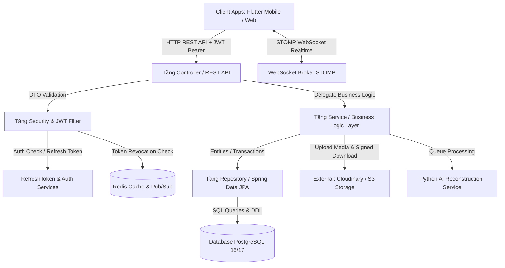
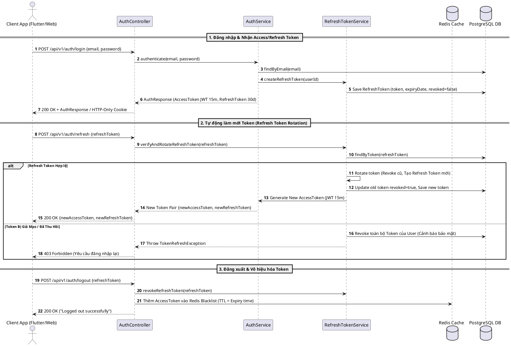
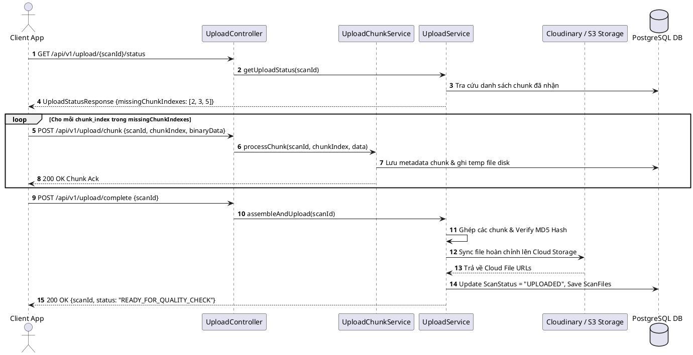
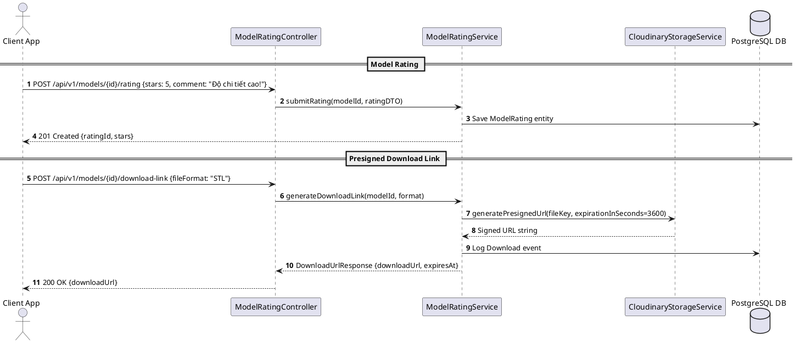

# 🏗️ Memento3D Backend - System Structure & Architecture Documentation

Tài liệu này mô tả chi tiết kiến trúc thiết kế, cấu trúc dự án, phân tầng lớp (Layered Architecture), luồng dữ liệu (Data Flow) và tổ chức các thành phần trong hệ thống **Memento3D Backend**.

---

## 📐 1. Tổng Quan Kiến Trúc (Architectural Pattern)

Memento3D Backend được xây dựng theo mô hình **Layered Architecture (Kiến trúc phân tầng)** chuẩn mực của Spring Boot 3 enterprise, kết hợp với:
- **JWT Authentication & Refresh Token Rotation**: Cơ chế xác thực an toàn với Access Token (ngắn hạn) và Refresh Token (dài hạn + Cookie/Storage).
- **Redis Cache & Pub/Sub System**: Quản lý Token Blacklist (Logout), Caching Scan Status & User Profile, đồng thời đóng vai trò Message Broker cho tiến độ 3D Reconstruction.
- **RESTful API & WebSocket STOMP Broker**: Cung cấp API chuẩn chuẩn hóa và kênh giao tiếp thời gian thực (Realtime Progress) cho client.
- **Cloudinary / S3 Integration**: Quản lý lưu trữ tệp đa phương tiện (ảnh/video scan) và xuất bản các mô hình 3D (.GLB, .STL, .OBJ) qua Signed URL.



---

## 📂 2. Cấu Trúc Thư Mục Chi Tiết (Directory Breakdown)

```text
Memento3D-Backend/
├── docker-compose.yml              # Root Docker Compose (Khởi tạo PostgreSQL 16 & Redis 7 containers)
├── README.md                       # Hướng dẫn khởi chạy & Cấu hình môi trường dự án
├── STRUCTURE.md                    # Tài liệu kiến trúc & Cấu trúc hệ thống Backend (File này)
└── memeto3D/                       # Ứng dụng chính Spring Boot 3.x (Java 17)
    ├── Dockerfile                  # Container build config (Multi-stage JDK 17 build)
    ├── docker-compose.yml          # Docker Compose khởi chạy Fullstack (Backend + DB + Redis)
    ├── pom.xml                     # Maven dependency & Plugin configuration
    ├── .env.example                # Biến môi trường mẫu (Database, Redis, JWT Secrets, Cloudinary)
    ├── db/
    │   └── init_schema.sql         # Script DDL khởi tạo toàn bộ bảng CSDL PostgreSQL
    ├── doc/
    │   └── BE_GUIDELINES.md        # Quy chuẩn phát triển mã nguồn Backend
    └── src/
        ├── main/
        │   ├── java/com/memeto/team/memeto3d/
        │   │   ├── Memeto3DApplication.java   # Entrypoint chính của ứng dụng Spring Boot
        │   │   │
        │   │   ├── config/                     # Lớp Cấu Hình Hệ Thống (Configuration Beans)
        │   │   │   ├── SecurityConfig.java       # Spring Security 6, CorsFilter & Auth Chains
        │   │   │   ├── RedisConfig.java          # RedisTemplate, CacheManager & PubSub config
        │   │   │   ├── WebSocketConfig.java      # Config STOMP Broker cho tin nhắn Realtime
        │   │   │   ├── CloudinaryConfig.java     # Bean tích hợp Cloudinary SDK storage
        │   │   │   ├── JacksonConfig.java        # Xử lý JSON Serialization & ISO Datetime
        │   │   │   └── OpenApiConfig.java        # Swagger UI / OpenAPI 3.0 Documentation
        │   │   │
        │   │   ├── controller/                 # Tầng REST Controllers (API Endpoints)
        │   │   │   ├── AuthController.java       # Xử lý /auth/login, /auth/refresh, /auth/logout, /auth/google
        │   │   │   ├── ScanController.java       # Quản lý phiên scan 3D, submit job tái tạo & status
        │   │   │   ├── UploadController.java     # Tiếp nhận & Quản lý Resumable Chunked Upload
        │   │   │   ├── QualityRunController.java # Kết quả kiểm tra chất lượng ảnh (Quality Check)
        │   │   │   ├── ModelRatingController.java# Đánh giá mô hình 3D & Sinh Presigned Download URL
        │   │   │   ├── UserController.java       # Quản lý thông tin hồ sơ & quyền hạn người dùng
        │   │   │   └── RedisMonitoringController.java # Dashboard giám sát Redis Cache & Queues cho Admin
        │   │   │
        │   │   ├── dto/                        # Data Transfer Objects (Payloads Request/Response)
        │   │   │   ├── AuthResponse.java, RefreshTokenRequest.java, LoginRequest.java, RegisterRequest.java
        │   │   │   ├── ScanCreateRequest.java, ScanResponse.java, ScanPatchRequest.java
        │   │   │   ├── UploadStatusResponse.java, ChunkUploadRequest.java
        │   │   │   ├── QualityRunResponse.java, ImageQualityDetailResponse.java
        │   │   │   ├── ModelRatingRequest.java, DownloadUrlResponse.java
        │   │   │   └── ErrorResponse.java
        │   │   │
        │   │   ├── entity/                     # Tầng JPA Entities (Các bảng trong CSDL PostgreSQL)
        │   │   │   ├── User.java, Role.java      # Thông tin người dùng & Phân quyền
        │   │   │   ├── RefreshToken.java         # Quản lý Refresh Token dài hạn & Token Rotation
        │   │   │   ├── Scan.java, ScanStatus.java# Phiên quét 3D & Trạng thái State Machine
        │   │   │   ├── ScanFile.java             # Metadata danh sách ảnh/video thuộc phiên scan
        │   │   │   ├── QualityRun.java, QualityMetric.java # Kết quả kiểm tra chất lượng ảnh tự động
        │   │   │   ├── ReconstructionJob.java    # Tiến trình tái tạo 3D bất đồng bộ
        │   │   │   ├── ModelRating.java          # Đánh giá & phản hồi chất lượng mô hình 3D
        │   │   │   ├── Order.java, OrderItem.java# Đơn hàng in 3D & Thương mại hoá
        │   │   │   └── BlacklistedToken.java     # Danh sách Token JWT đã bị thu hồi khi Logout
        │   │   │
        │   │   ├── exception/                  # Quản lý & Xử lý Lỗi Toàn cục (Global Exceptions)
        │   │   │   ├── GlobalExceptionHandler.java # Bắt exception toàn cục & trả về ErrorResponse chuẩn
        │   │   │   ├── ResourceNotFoundException.java, InvalidTokenException.java
        │   │   │   ├── TokenRefreshException.java, ChunkUploadException.java
        │   │   │   └── UnauthorizedAccessException.java
        │   │   │
        │   │   ├── repository/                 # Tầng Truy Vấn Dữ Liệu (Spring Data JPA)
        │   │   │   ├── UserRepository.java, RefreshTokenRepository.java, BlacklistedTokenRepository.java
        │   │   │   ├── ScanRepository.java, ScanFileRepository.java
        │   │   │   ├── QualityRunRepository.java, ReconstructionJobRepository.java
        │   │   │   ├── ModelRatingRepository.java, OrderRepository.java
        │   │   │
        │   │   ├── security/                   # Tầng Bảo Mật & Xác Thực JWT / OAuth2
        │   │   │   ├── JwtAuthenticationFilter.java  # Interceptor lọc và kiểm tra JWT Access Token
        │   │   │   ├── JwtTokenProvider.java       # Sinh, giải mã & kiểm tra tính hợp lệ của JWT
        │   │   │   ├── CustomUserDetails.java     # Implement UserDetails của Spring Security
        │   │   │   ├── CustomUserDetailsService.java # Load thông tin người dùng từ PostgreSQL
        │   │   │   ├── OAuth2SuccessHandler.java   # Xử lý callback đăng nhập qua Google OAuth2
        │   │   │   └── JwtAuthenticationEntryPoint.java # Xử lý các lỗi xác thực 401 Unauthorized
        │   │   │
        │   │   └── service/                    # Tầng Xử Lý Nghiệp Vụ (Business Logic Layer)
        │   │       ├── AuthService.java            # Đăng ký, Đăng nhập Email/Pass, Google OAuth2
        │   │       ├── RefreshTokenService.java    # Cấp mới Access Token, xoay Refresh Token (Rotation)
        │   │       ├── TokenBlacklistService.java  # Thu hồi Token qua Redis Cache khi Logout
        │   │       ├── ScanService.java            # Quản lý vòng đời Scan, Submit Job & State
        │   │       ├── UploadService.java          # Tổng hợp dữ liệu & lưu trữ CDN Cloudinary
        │   │       ├── UploadChunkService.java     # Tiếp nhận các chunk file tải lên phân đoạn
        │   │       ├── QualityRunService.java      # Tính toán điểm số & đánh giá chất lượng bộ ảnh
        │   │       ├── ModelRatingService.java     # Lưu đánh giá & cấp Signed Download Link cho STL/GLB
        │   │       ├── UserService.java            # Quản lý profile người dùng & cập nhật thông tin
        │   │       ├── UserCacheService.java       # Caching thông tin user profile trên Redis
        │   │       ├── ScanStatusCacheService.java # Caching trạng thái tiến trình Scan trên Redis
        │   │       ├── RedisMonitoringService.java # Tra cứu chỉ số Redis cho màn hình Admin
        │   │       ├── CloudinaryStorageService.java# Tạo Signed URL & Giao tiếp Cloud Storage SDK
        │   │       ├── CacheInvalidationService.java# Xóa & Cập nhật Cache khi dữ liệu biến động
        │   │       └── impl/                   # Các lớp triển khai chi tiết (Implementations)
        │   │           ├── AuthServiceImpl.java, RefreshTokenServiceImpl.java
        │   │           ├── ScanServiceImpl.java, UploadServiceImpl.java, UploadChunkServiceImpl.java
        │   │           ├── QualityRunServiceImpl.java, ModelRatingServiceImpl.java
        │   │           ├── UserServiceImpl.java, TokenBlacklistServiceImpl.java
        │   │           └── RedisMonitoringServiceImpl.java
        │   │
        │   └── resources/
        │       ├── application.yml             # Cấu hình Spring Boot chính (Database, Redis, JWT, OAuth2)
        │       ├── application-dev.yml         # Environment config cho Môi trường phát triển
        │       ├── application-prod.yml        # Environment config cho Môi trường Production
        │       └── data.sql                    # Script nạp dữ liệu mẫu ban đầu (Roles, Admin Accounts)
        └── test/                               # Kiểm thử tự động (Unit & Integration Tests)
            └── java/com/memeto/team/memeto3d/
                ├── controller/                 # Integration tests cho REST Controllers
                ├── service/                    # Unit tests cho các Service nghiệp vụ
                └── ScanControllerIntegrationTest.java
```

---

## 🔄 3. Vai Trò & Nhiệm Vụ Các Tầng (Layer Responsibilities)

### 1. Tầng Controller (`controller/`)
- Đầu mối nhận HTTP REST Requests từ Flutter App hoặc Client Web.
- Sử dụng `@Valid` để kiểm tra tính hợp lệ dữ liệu DTO đầu vào.
- Trả về cấu trúc JSON chuẩn mực kèm trạng thái HTTP Code (`200 OK`, `201 Created`, `400 Bad Request`, `401 Unauthorized`, `403 Forbidden`, `404 Not Found`).

### 2. Tầng Security & JWT (`security/` & `config/SecurityConfig.java`)
- **JwtAuthenticationFilter**: Kiểm tra Header `Authorization: Bearer <Access_Token>`.
- **Token Blacklist Check**: Kiểm tra xem Access Token có nằm trong danh sách thu hồi trên **Redis** hay không (Logout protection).
- **OAuth2 Integration**: Hỗ trợ Đăng nhập bằng Google qua `OAuth2SuccessHandler`.
- **Refresh Token Rotation**: Xử lý làm mới Access Token mà không làm gián đoạn trải nghiệm người dùng qua `/api/v1/auth/refresh`.

### 3. Tầng Service & Caching (`service/` & `service/impl/`)
- Thực thi toàn bộ **Business Logic** và quản lý giao dịch CSDL với `@Transactional`.
- **Hệ thống Caching bằng Redis**:
  - `UserCacheService`: Giảm tải DB khi tra cứu thông tin User trên mỗi request authenticated.
  - `ScanStatusCacheService`: Cập nhật và lưu giữ trạng thái xử lý Scan realtime.
  - `CacheInvalidationService`: Chủ động xóa/cập nhật Cache khi có thao tác Mutation (Cập nhật Profile, Xóa Scan).

### 4. Tầng Repository (`repository/`)
- Giao tiếp với PostgreSQL thông qua **Spring Data JPA**.
- Cung cấp các hàm truy vấn có sẵn hoặc tùy biến qua `@Query` (JPQL/Native SQL).
- Quản lý các mối quan hệ Entity phức tạp (`OneToMany`, `ManyToOne`, `OneToOne`).

### 5. Tầng Database Schema (`db/init_schema.sql` & Entity Models)
PostgreSQL 16/17 được thiết kế chuẩn hóa 3NF gồm các bảng chủ đạo:
- **Xác thực & Người dùng**: `users`, `roles`, `refresh_tokens`, `token_blacklist`.
- **Thu thập & Tải lên**: `scans`, `scan_files`, `upload_sessions`, `upload_chunks`.
- **Kiểm tra & Tái tạo 3D**: `quality_runs`, `quality_metrics`, `reconstruction_jobs`.
- **Thương mại & Đánh giá**: `orders`, `order_items`, `model_ratings`.

---

## ⚡ 4. Các Luồng Xử Lý Dữ Liệu Đặc Thụ (PlantUML Sequence Diagrams)

### 4.1 Luồng Xác Thực & Refresh Token System (JWT + Token Rotation)



---

### 4.2 Luồng Tải Lên Phân Đoạn Resumable Chunked Upload



---

### 4.3 Luồng Đánh Giá Mô Hình 3D & Sinh Presigned Signed Download URL



---

## 🔗 5. Liên Kết Mới & Tài Liệu Liên Quan

- [SYSTEM_SEQUENCE_DIAGRAMS_AND_FILE_STRUCTURE.md](file:///c:/Users/KIETLT/Documents/GitHub/Memento3d/Memento3D-Doc/doc/SYSTEM_SEQUENCE_DIAGRAMS_AND_FILE_STRUCTURE.md) — Sơ đồ Sequence Diagrams PlantUML & Cấu trúc hệ thống toàn cục.
- [README.md](file:///c:/Users/KIETLT/Documents/GitHub/Memento3d/Memento3D-Backend/README.md) — Hướng dẫn cài đặt & chạy dự án Backend.
- [BE_GUIDELINES.md](file:///c:/Users/KIETLT/Documents/GitHub/Memento3d/Memento3D-Backend/memeto3D/doc/BE_GUIDELINES.md) — Quy chuẩn viết code & conventions Backend.
- [init_schema.sql](file:///c:/Users/KIETLT/Documents/GitHub/Memento3d/Memento3D-Backend/memeto3D/db/init_schema.sql) — File khởi tạo PostgreSQL Database Schema.
