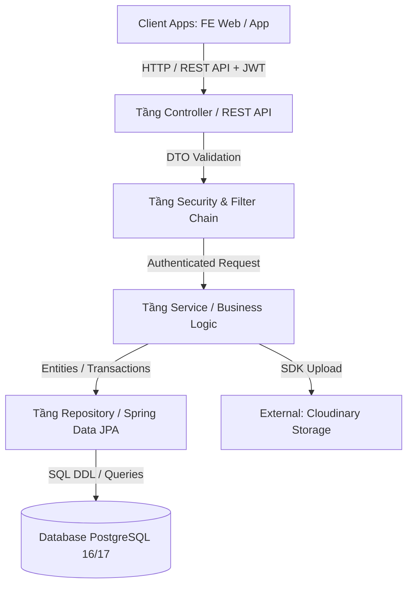
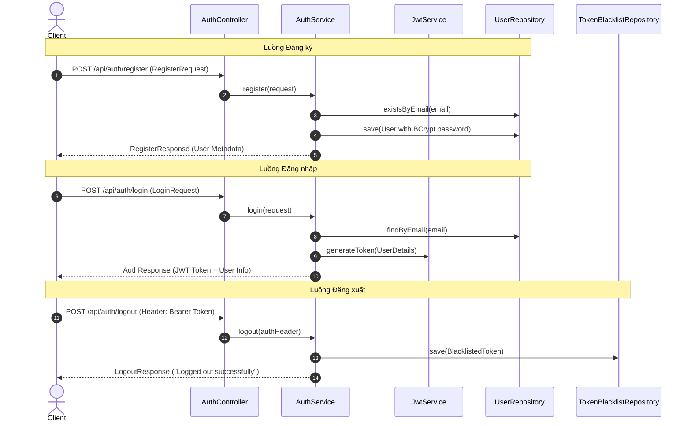
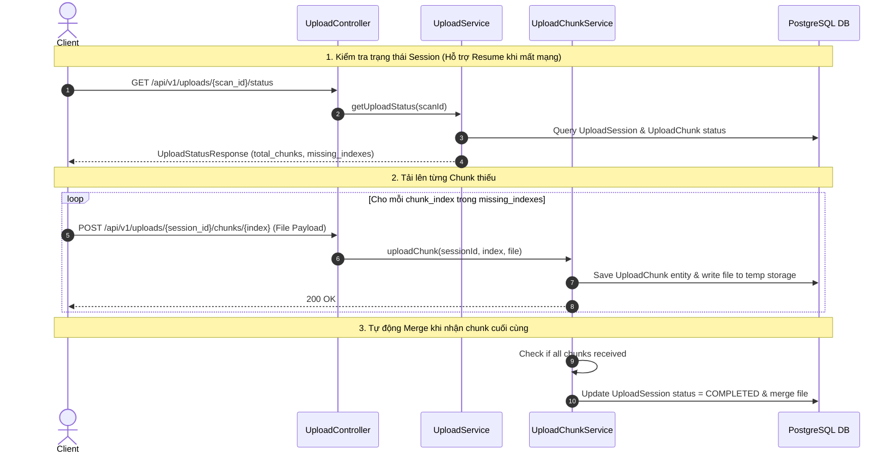
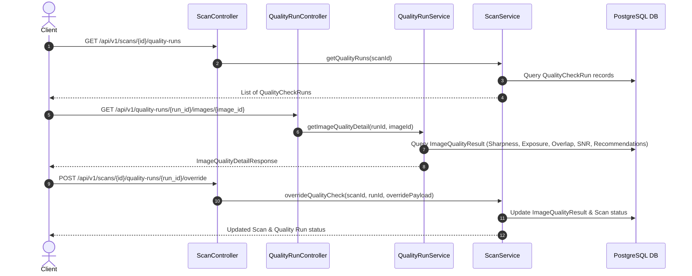

# 🏗️ Memento3D Backend - System Structure & Architecture Documentation

Tài liệu này mô tả chi tiết kiến trúc thiết kế, cấu trúc dự án, phân tầng lớp (Layered Architecture), luồng dữ liệu (Data Flow) và tổ chức các thành phần trong hệ thống **Memento3D Backend**.

---

## 📐 1. Tổng Quan Kiến Trúc (Architectural Pattern)

Memento3D Backend được xây dựng theo mô hình **Layered Architecture (Kiến trúc phân tầng)** chuẩn mực của Spring Boot enterprise, kết hợp với các nguyên lý thiết kế RESTful API, JWT Security, và Event-Driven Outbox pattern sẵn sàng cho việc mở rộng hệ thống Microservices.



---

## 📂 2. Cấu Trúc Thư Mục Chi Tiết (Directory Breakdown)

```text
Memento3D-Backend/
├── docker-compose.yml              # Root Docker Compose (Khởi tạo PostgreSQL Database container)
├── README.md                       # Tài liệu hướng dẫn sử dụng & Khởi chạy dự án
├── STRUCTURE.md                    # Tài liệu kiến trúc & Cấu trúc hệ thống Backend (File này)
└── memeto3D/                       # Ứng dụng chính Spring Boot
    ├── Dockerfile                  # Container build config (Multi-stage JDK 17 build)
    ├── docker-compose.yml          # Docker Compose khởi chạy Fullstack (Backend + DB)
    ├── pom.xml                     # Quản lý thư viện & Plugin build (Maven)
    ├── .env.example                # Biến môi trường mẫu
    ├── db/
    │   └── init_schema.sql         # Script DDL khởi tạo toàn bộ 25+ bảng PostgreSQL
    ├── doc/
    │   └── BE_GUIDELINES.md        # Quy chuẩn phát triển Backend
    └── src/
        ├── main/
        │   ├── java/com/memeto/team/memeto3D/
        │   │   ├── Memeto3DApplication.java   # Main Spring Boot Application Entrypoint
        │   │   │
        │   │   ├── config/                     # Lớp Cấu Hình Hệ Thống (Configuration)
        │   │   │   ├── CloudinaryConfig.java     # Bean cấu hình tích hợp Cloudinary SDK
        │   │   │   ├── JacksonConfig.java        # Bean xử lý JSON Serialization & Datetime
        │   │   │   ├── OpenApiConfig.java        # Bean cấu hình Swagger UI / OpenAPI 3.0
        │   │   │   └── SecurityConfig.java       # Bean cấu hình Spring Security & CORS Filter
        │   │   │
        │   │   ├── controller/                 # Tầng REST Controllers (API Endpoints)
        │   │   │   ├── AuthController.java       # Xử lý Đăng ký, Đăng nhập, Profile, Logout
        │   │   │   ├── ScanController.java       # Quản lý phiên quét 3D, Upload ảnh/video, Override
        │   │   │   ├── QualityRunController.java # Tra cứu chi tiết kết quả kiểm tra chất lượng ảnh
        │   │   │   └── UploadController.java     # Tiếp nhận & Quản lý Resumable Chunked Upload
        │   │   │
        │   │   ├── dto/                        # Data Transfer Objects (Payloads Request/Response)
        │   │   │   ├── AuthResponse.java, RegisterRequest.java, LoginRequest.java
        │   │   │   ├── ScanCreateRequest.java, ScanResponse.java, ScanPatchRequest.java
        │   │   │   ├── UploadStatusResponse.java, ImageQualityDetailResponse.java
        │   │   │   └── ErrorResponse.java
        │   │   │
        │   │   ├── entity/                     # Tầng JPA Entities (Đại diện các Bảng DB)
        │   │   │   ├── User.java, Role.java      # Người dùng & Quyền hạn
        │   │   │   ├── Scan.java, ScanStatus.java# Trạng thái & Phiên quét 3D
        │   │   │   ├── ScanImage.java, ScanVideo.java # Metadata của tài nguyên ảnh & video scan
        │   │   │   ├── UploadSession.java, UploadChunk.java # Quản lý session upload phân đoạn
        │   │   │   ├── QualityCheckRun.java      # Phiên chạy kiểm tra chất lượng ảnh
        │   │   │   ├── ImageQualityResult.java   # Kết quả phân tích chất lượng cho từng ảnh
        │   │   │   └── BlacklistedToken.java     # Danh sách Token JWT đã bị thu hồi/đăng xuất
        │   │   │
        │   │   ├── exception/                  # Xử lý Lỗi & 外例 (Global Exception Handler)
        │   │   │   ├── GlobalExceptionHandler.java # Bắt lỗi toàn cục & chuẩn hóa ErrorResponse
        │   │   │   ├── ResourceNotFoundException.java, InvalidTokenException.java
        │   │   │   └── ChunkUploadException.java
        │   │   │
        │   │   ├── repository/                 # Tầng Truy Vấn Dữ Liệu (Spring Data JPA)
        │   │   │   ├── UserRepository.java, BlacklistedTokenRepository.java
        │   │   │   ├── ScanRepository.java, ScanImageRepository.java, ScanVideoRepository.java
        │   │   │   ├── UploadSessionRepository.java, UploadChunkRepository.java
        │   │   │   ├── QualityCheckRunRepository.java, ImageQualityResultRepository.java
        │   │   │
        │   │   ├── security/                   # Tầng Bảo Mật & Xác Thực JWT
        │   │   │   ├── CustomUserDetails.java     # Implement UserDetails của Spring Security
        │   │   │   ├── CustomUserDetailsService.java # Load thông tin user từ PostgreSQL
        │   │   │   ├── JwtAuthenticationFilter.java  # Interceptor lọc và kiểm tra JWT Bearer Token
        │   │   │   ├── JwtAuthenticationEntryPoint.java # Xử lý lỗi 401 Unauthorized
        │   │   │   └── JwtService.java            # Tạo, giải mã & validate JWT Token
        │   │   │
        │   │   └── service/                    # Tầng Xử Lý Nghiệp Vụ (Business Logic Layer)
        │   │       ├── AuthService.java, ScanService.java, UploadService.java
        │   │       ├── UploadChunkService.java, QualityRunService.java
        │   │       ├── CloudinaryStorageService.java, TokenBlacklistService.java
        │   │       └── impl/                   # Lớp hiện thực hóa (Implementations)
        │   │           ├── AuthServiceImpl.java
        │   │           ├── ScanServiceImpl.java
        │   │           ├── UploadServiceImpl.java
        │   │           ├── QualityRunServiceImpl.java
        │   │           └── DatabaseTokenBlacklistService.java
        │   │
        │   └── resources/
        │       └── application.properties      # Cấu hình tham số Spring Boot (DB, Cloudinary, JWT)
        └── test/                               # Mã nguồn kiểm thử (Unit & Integration Tests)
```

---

## 🔄 3. Vai Trò & Nhiệm Vụ Các Tầng (Layer Responsibilities)

### 1. Tầng Controller (`controller/`)
- Đóng vai trò là đầu mối tiếp nhận các yêu cầu HTTP (REST API) từ Frontend/Mobile App.
- Nhận dữ liệu đầu vào qua `@RequestBody`, `@RequestParam`, `@PathVariable`, `@RequestHeader`.
- Thực hiện **Data Validation** tự động thông qua Annotation `@Valid` (Jakarta Validation).
- Ủy quyền (Delegate) xử lý logic cho tầng Service tương ứng.
- Trả về đối tượng `ResponseEntity<T>` kèm theo HTTP Status Code chuẩn (200, 201, 400, 401, 404, 409).

### 2. Tầng Security (`security/` & `config/SecurityConfig.java`)
- Kiểm tra tính hợp lệ của HTTP Authorization Header (`Bearer <JWT>`).
- Vô hiệu hóa truy cập nếu Token nằm trong danh sách **Blacklist** (Token đã bị đăng xuất).
- Thiết lập thông tin người dùng hiện tại vào `SecurityContextHolder`.
- Cấu hình phân quyền endpoint (Public APIs vs Authenticated APIs) và quy tắc CORS.

### 3. Tầng Service (`service/` & `service/impl/`)
- Chứa toàn bộ **Business Logic (Quy trình nghiệp vụ)** của hệ thống.
- Quản lý **Transactions (`@Transactional`)** đảm bảo tính toàn vẹn dữ liệu.
- Xử lý các quy trình phức tạp:
  - Ghép nối các mảnh file upload (Chunk Merging).
  - Tải tài nguyên lên CDN Cloudinary.
  - Phân tích và đánh giá điểm số chất lượng ảnh.
  - Kiểm tra quyền sở hữu dữ liệu (Chống lỗi IDOR - Insecure Direct Object Reference).

### 4. Tầng Repository (`repository/`)
- Sử dụng **Spring Data JPA** để giao tiếp với PostgreSQL.
- Định nghĩa các hàm truy vấn theo quy chuẩn đặt tên (`findByEmail`, `findByScanIdAndStatus`,...) hoặc viết câu lệnh `@Query` (JPQL/Native SQL).
- Hỗ trợ Phân trang (`Pageable`) và Sắp xếp (`Sort`).

### 5. Tầng Database Schema (`db/init_schema.sql`)
- Hệ quản trị CSDL: **PostgreSQL 16/17**.
- Quản lý hơn 25+ bảng được phân nhóm thành các Sub-domain:
  - **Auth Domain**: `users`, `refresh_tokens`, `token_blacklist`.
  - **Scan Domain**: `scans`, `scan_images`, `scan_videos`.
  - **Upload Domain**: `upload_sessions`, `upload_chunks`.
  - **Quality Inspection Domain**: `quality_check_runs`, `image_quality_results`.
  - **Reconstruction 3D Domain**: `reconstruction_jobs`, `job_stage_logs`, `reconstruction_metrics`, `model_outputs`, `preview_links`, `download_logs`.
  - **E-Commerce Domain**: `payments`, `print_orders`, `order_status_history`, `model_ratings`.
  - **System Operations**: `audit_logs`, `system_configs`, `daily_stats`, `notifications`, `outbox_events`, `dead_letter_events`.

---

## ⚡ 4. Các Luồng Xử Lý Dữ Liệu Đặc Thụ (Key Data Flows)

### 4.1 Luồng Xác Thực (Authentication Flow)



---

### 4.2 Luồng Resumable Chunked Upload (Tải Lên Phân Đoạn)



---

### 4.3 Luồng Kiểm Tra Chất Lượng Ảnh (Quality Inspection & Override Flow)



---

## 🔗 5. Liên Kết Mới & Tài Liệu Liên Quan
- [README.md](file:///c:/Users/KIETLT/Documents/GitHub/Memento3d/Memento3D-Backend/README.md) — Tài liệu hướng dẫn sử dụng & Khởi chạy dự án.
- [BE_GUIDELINES.md](file:///c:/Users/KIETLT/Documents/GitHub/Memento3d/Memento3D-Backend/memeto3D/doc/BE_GUIDELINES.md) — Quy chuẩn mã nguồn Backend.
- [init_schema.sql](file:///c:/Users/KIETLT/Documents/GitHub/Memento3d/Memento3D-Backend/memeto3D/db/init_schema.sql) — File khởi tạo PostgreSQL Database Schema.
