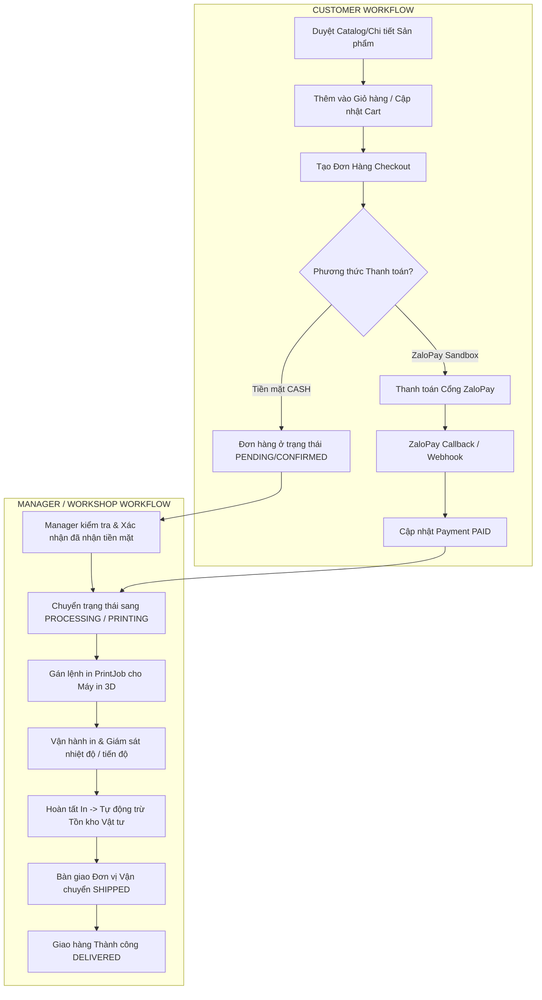

# MEMENTO3D: TÀI LIỆU HỆ THỐNG TOÀN DIỆN
## Kiến trúc, Tác nhân (Actors), Tất cả các Luồng (Workflows) & Hướng dẫn Vận hành

---

## MỤC LỤC
1. [Tổng quan Hệ thống Memento3D](#1-tổng-quan-hệ-thống-memento3d)
2. [Các Actor & Ma trận Phân quyền (Roles & Permissions)](#2-các-actor--ma-trận-phân-quyền)
3. [Tất cả các Luồng Nghiệp vụ (Workflows & State Machines)](#3-tất-cả-các-luồng-nghiệp-vụ)
   - [3.1. Luồng Xác thực & Phân quyền (Auth & Security)](#31-luồng-xác-thực--phân-quyền)
   - [3.2. Luồng Khám phá & Mua sắm (Catalog & Cart)](#32-luồng-khám-phá--mua-sắm)
   - [3.3. Luồng Đặt hàng & Vòng đời Đơn hàng (Order State Machine)](#33-luồng-đặt-hàng--vòng-đời-đơn-hàng)
   - [3.4. Luồng Thanh toán (Payment: CASH & ZaloPay)](#34-luồng-thanh-toán-payment-cash--zalopay)
   - [3.5. Luồng Quét & Tái tạo mô hình 3D (3D Scanning & AI Reconstruction)](#35-luồng-quét--tái-tạo-mô-hình-3d)
   - [3.6. Luồng Vận hành In 3D & Khấu hao Vật tư (Print Operations)](#36-luồng-vận-hành-in-3d--khấu-hao-vật-tư)
   - [3.7. Luồng Quản trị Kho & Nguyên vật liệu (WMS & Materials)](#37-luồng-quản-trị-kho--nguyên-vật-liệu)
4. [Hướng dẫn Cài đặt & Khởi chạy Hệ thống](#4-hướng-dẫn-cài-đặt--khởi-chạy-hệ-thống)
5. [Kịch bản Đi Workflow Mẫu (End-to-End Walkthrough)](#5-kịch-bản-đi-workflow-mẫu)

---

## 1. TỔNG QUAN HỆ THỐNG MEMENTO3D

**Memento3D** là nền tảng thương mại điện tử kết hợp xưởng chế tác 3D cá nhân hóa thông minh:
- **Frontend Web**: React 19, TypeScript, Vite, TailwindCSS / Vanilla CSS, React Router v6.
- **Backend Core**: Java 21+ / Java 25, Spring Boot 4.x / Spring Data JPA, Hibernate 7, Spring Security 6.x (Stateless JWT).
- **Cơ sở dữ liệu**: PostgreSQL 18 (Neon Cloud Serverless), Flyway Migration (V1 -> V12).
- **Bộ nhớ đệm & Task Queue**: Redis (Lettuce Client, Spring Data Redis).
- **Lưu trữ Media**: Cloudinary API (Hình ảnh thành phẩm, texture, video quét mẫu).

---

## 2. CÁC ACTOR & MA TRẬN PHÂN QUYỀN

Hệ thống định nghĩa 7 Actor chuyên biệt tương ứng với các Role trong cơ sở dữ liệu (`Role` enum):

| Actor | Role Code | Cổng đăng nhập | Không gian làm việc (Home) | Quyền hạn & Trách nhiệm chính |
|---|---|---|---|---|
| **CUSTOMER** | `ROLE_USER` | `/login` | `/customer/home` | Khách hàng mua sắm: duyệt 10 danh mục, đặt hàng, thanh toán ZaloPay/CASH, tải ảnh/video scan 3D, theo dõi tiến độ in và vận chuyển đơn hàng. |
| **MANAGER** | `ROLE_MANAGER` | `/manager/login` | `/manager/home` | Quản lý vận hành xưởng & bán hàng: quản lý danh mục & sản phẩm, duyệt đơn hàng, xác nhận tiền mặt (CASH), điều phối máy in, quản lý kho vật tư và nhập/xuất kho. |
| **ADMIN** | `ROLE_ADMIN` | `/admin/login` | `/admin/home` | Quản trị viên cấp cao nhất: toàn quyền hệ thống, quản lý tài khoản người dùng, phân quyền kho (`WarehouseMembership`), xem toàn bộ audit logs, tài chính và cấu hình hệ thống. |
| **WAREHOUSE**| `ROLE_WAREHOUSE`| `/warehouse/login`| `/warehouse/home` | Thủ kho WMS: nhập kho theo số lô (Goods Receipts), xuất kho sản xuất (Stock Issues), kiểm kê sổ cái tồn kho, cấp phát cuộn sợi nhựa in 3D. |
| **OPERATOR** | `ROLE_OPERATOR` | `/operator/login` | `/operator/home` | Kỹ thuật viên xưởng: kiểm định ảnh scan (QC Gate), giám sát máy in 3D, vận hành Print Jobs, quyết toán tiêu hao vật tư sau khi in xong. |
| **PROVIDER** | `ROLE_PROVIDER` | `/provider/login` | `/provider/home` | Đối tác xưởng in 3D: tiếp nhận và sản xuất các đơn hàng gia công ngoài theo hợp đồng hợp tác B2B. |
| **DRIVER** | `ROLE_DRIVER` | `/driver/login` | `/driver/home` | Đội ngũ giao vận: nhận kiện hàng thành phẩm tại kho, điều phối lộ trình giao hàng hỏa tốc, chụp ảnh xác nhận giao hàng thành công. |

### Bảng tài khoản Demo Seeder sẵn trong hệ thống:
*Tất cả tài khoản đều đã kích hoạt email (`email_verified = true`, `status = ACTIVE`) với mật khẩu mặc định:* **`123456`**

| Phân hệ / Actor | Email chính thức | Email phụ | Mật khẩu | Cổng đăng nhập |
|---|---|---|---|---|
| **Khách hàng** | `customer@memento3d.vn` | `user@memento3d.com` | `123456` | `http://localhost:5173/login` |
| **Quản trị viên** | `admin@memento3d.vn` | `admin@memento3d.com` | `123456` | `http://localhost:5173/admin/login` |
| **Quản lý Vận hành** | `manager@memento3d.vn` | `manager@memento3d.com` | `123456` | `http://localhost:5173/manager/login` |
| **Thủ kho WMS** | `warehouse@memento3d.vn` | `warehouse@memento3d.com` | `123456` | `http://localhost:5173/warehouse/login` |
| **Kỹ thuật viên In** | `operator@memento3d.vn` | `operator@memento3d.com` | `123456` | `http://localhost:5173/operator/login` |
| **Đối tác Xưởng in** | `provider@memento3d.vn` | `provider@memento3d.com` | `123456` | `http://localhost:5173/provider/login` |
| **Tài xế Giao vận** | `driver@memento3d.vn` | `driver@memento3d.com` | `123456` | `http://localhost:5173/driver/login` |

---

## 3. TẤT CẢ CÁC LUỒNG NGHIỆP VỤ (WORKFLOWS)



---

### 3.1. Luồng Xác thực & Phân quyền (Auth & Security)
1. **Đăng ký / Đăng nhập**:
   - `POST /api/v1/auth/login`: Nhận `email` và `password`. Trả về `accessToken` (JWT), `refreshToken` và thông tin User (`role`, `fullName`, `avatarUrl`).
2. **Cơ chế phân quyền SpEL chuẩn xác**:
   - Hệ thống sử dụng `@PreAuthorize("hasAnyRole('ADMIN', 'MANAGER')")` trên các Controller (không lặp tiền tố `ROLE_` để loại trừ lỗi `duplicate element`).
3. **Stateful Logout & Blacklist**:
   - Đăng xuất sẽ lưu JWT token vào bảng `BlacklistedToken` có TTL tương ứng hạn sống token.

---

### 3.2. Luồng Khám phá & Mua sắm (Catalog & Cart)
1. **Danh mục sản phẩm**:
   - `GET /api/v1/product-categories?activeOnly=true`: Lấy danh sách danh mục (Lithophane kỷ niệm, Tượng chân dung Chibi, Tranh phù điêu...).
2. **Danh sách sản phẩm**:
   - `GET /api/v1/products?page=0&size=12&categorySlug=...&keyword=...&sort=popular`: Truy vấn danh sách có hỗ trợ phân trang, lọc theo giá, danh mục, từ khóa tìm kiếm (được tối ưu với `CAST(:keyword AS string)` trên PostgreSQL).
3. **Giỏ hàng lưu trữ Database (Cart)**:
   - `GET /api/v1/cart`: Lấy giỏ hàng của User hiện tại.
   - `POST /api/v1/cart/items`: Thêm sản phẩm vào giỏ kèm số lượng (`quantity`).
   - `PATCH /api/v1/cart/items/{itemId}`: Tăng/giảm số lượng.
   - `DELETE /api/v1/cart/items/{itemId}`: Xóa sản phẩm khỏi giỏ.

---

### 3.3. Luồng Đặt hàng & Vòng đời Đơn hàng (Order State Machine)
Mỗi đơn hàng tuân thủ máy trạng thái nghiêm ngặt (`OrderStatus`):

```
PENDING (Chờ thanh toán)
   │
   ├── [Thanh toán ZaloPay thành công / Manager Xác nhận Tiền mặt CASH]
   ▼
CONFIRMED (Đã xác nhận thanh toán)
   │
   ├── [Quản lý gửi lệnh sản xuất xưởng in]
   ▼
PROCESSING (Đang chuẩn bị mô hình / file G-code)
   │
   ├── [Máy in nhận job và bắt đầu in lớp nhựa]
   ▼
PRINTING (Đang in 3D)
   │
   ├── [In xong, xử lý bề mặt, đóng gói]
   ▼
SHIPPED (Bàn giao đối tác giao vận)
   │
   ├── [Khách nhận hàng thành công]
   ▼
DELIVERED (Giao hàng thành công)
```
*(Đơn hàng có thể bị `CANCELLED` khi ở trạng thái `PENDING` hoặc `CONFIRMED`).*

---

### 3.4. Luồng Thanh toán (Payment: CASH & ZaloPay)
1. **Thanh toán Tiền mặt (CASH)**:
   - Khách hàng tạo đơn với `paymentMethod = CASH`.
   - Đơn hàng được tạo ở trạng thái `CONFIRMED`, `PaymentTransaction` ở trạng thái `PENDING`.
   - Khi Shipper hoặc Manager nhận được tiền mặt, Manager nhấn **"Xác nhận đã nhận tiền"** trên màn hình `ManagerOrderDetailPage`:
     - Gọi API: `POST /api/v1/payments/{paymentId}/confirm-cash`
     - Hệ thống kiểm tra quyền (`ROLE_MANAGER`, `ROLE_ADMIN`, `ROLE_OPERATOR`), cập nhật giao dịch sang `SUCCESS` và đánh dấu đơn hàng `PAID`.
2. **Thanh toán ZaloPay Sandbox**:
   - Gọi API: `POST /api/v1/payments/zalopay/create` truyền `orderId`.
   - Backend gọi ZaloPay API tạo `order_url`, Frontend chuyển hướng khách hàng sang cổng quét mã QR ZaloPay.
   - ZaloPay Server gửi IPN Callback về: `POST /api/v1/payments/zalopay/callback`. Backend xác thực chữ ký HMAC-SHA256 và tự động cập nhật đơn hàng thành `PAID`.

---

### 3.5. Luồng Quét & Tái tạo mô hình 3D (3D Scanning & AI Reconstruction)
1. **Upload Scan Session**:
   - Khách hàng tải lên chuỗi 20–100 ảnh góc chụp hoặc video 360 độ quay đối tượng.
   - Các file được lưu trữ bảo mật trên Cloudinary.
2. **Kiểm tra chất lượng (Image Quality Check)**:
   - AI Worker đánh giá độ sắc nét, ánh sáng và độ phủ góc chụp (`ImageQualityResult`).
3. **Reconstruction Job**:
   - Khởi tạo job tái tạo với NeRF / Gaussian Splatting / Photogrammetry.
   - Backend hỗ trợ `MockReconstructionJobRunner` mô phỏng tiến độ xử lý tự động trong môi trường phát triển (10% -> 50% -> 100% -> xuất file `.obj` / `.glb` hoàn chỉnh).

---

### 3.6. Luồng Vận hành In 3D & Khấu hao Vật tư (Print Operations)
1. **Tạo Print Job**:
   - Lệnh in được tạo từ `OrderItem` hoặc mô hình 3D đã duyệt.
   - Gán máy in (`Printer` - ví dụ: *Bambu Lab X1-Carbon*, *Elegoo Saturn 4 Ultra*).
2. **Trừ tồn kho vật tư tự động (Material Consumption)**:
   - Khi Print Job chuyển sang trạng thái `COMPLETED`:
   - Dịch vụ `PrintJobServiceImpl` tự động ghi nhận số gram nhựa PLA/PETG hoặc ml Resin đã tiêu thụ (`PrintJobConsumption`), và gọi sang `InventoryService` để trừ lượng tồn kho tương ứng trong kho chỉ định.

---

### 3.7. Luồng Quản trị Kho & Nguyên vật liệu (WMS & Materials)
- **Quản lý nguyên liệu (Material)**: Mã SKU, màu sắc, loại nhựa, mật độ, giá nhập.
- **Phiếu Nhập kho (Goods Receipt)**: Ghi nhận nhập cuộn nhựa/thùng resin từ nhà cung cấp, tăng `InventoryBalance`.
- **Phiếu Xuất kho (Stock Issue / Enterprise Issue)**: Xuất vật tư cho dây chuyền xưởng in hoặc khách hàng doanh nghiệp.
- **Phiếu Điều chuyển kho (Warehouse Transfer)**: Chuyển vật tư giữa Kho Trung Tâm (Main Hub) và Kho Chi Nhánh Xưởng (Workshop Hub).
- **Phiếu Kiểm kê & Điều chỉnh (Stock Count & Adjustment)**: Đối soát số lượng thực tế và số lượng trên sổ sách, tự động tạo bút toán điều chỉnh chênh lệch.

---

## 4. HƯỚNG DẪN CÀI ĐẶT & KHỞI CHẠY HỆ THỐNG

### 4.1. Yêu cầu Hệ thống
- **Java**: JDK 21 hoặc mới hơn (Project hỗ trợ JDK 25).
- **Node.js**: v18.x trở lên (npm v10+).
- **PostgreSQL**: Cấu hình sẵn kết nối Neon Cloud qua Flyway trong `application.yml`.
- **Redis**: Đang chạy trên `localhost:6379` hoặc Redis Cloud.

### 4.2. Khởi chạy Backend (Spring Boot)
1. Mở terminal tại thư mục Backend:
   ```powershell
   cd C:\Users\KIETLT\Documents\GitHub\Memento3d\Memento3D-Backend\memeto3D
   ```
2. Chạy ứng dụng bằng Maven Wrapper:
   ```powershell
   .\mvnw.cmd spring-boot:run
   ```
   *(Hoặc mở bằng IntelliJ IDEA và bấm **Run Memento3DApplication**).*
3. Backend khởi chạy thành công tại: `http://localhost:8080/`
   - Tài liệu API Swagger UI: `http://localhost:8080/swagger-ui.html`
   - Dữ liệu mẫu (Users, Warehouses, Materials, Products, Orders) sẽ tự động được gieo qua `InventoryDataSeeder`.

### 4.3. Khởi chạy Frontend Web (React + Vite)
1. Mở terminal tại thư mục Frontend:
   ```powershell
   cd C:\Users\KIETLT\Documents\GitHub\Memento3d\Memento3D-Fronted-Web
   ```
2. Cài đặt dependencies (nếu chưa cài):
   ```powershell
   npm install
   ```
3. Khởi chạy dev server:
   ```powershell
   npm run dev
   ```
4. Truy cập giao diện ứng dụng tại: `http://localhost:5173/`.

---

## 5. KỊCH BẢN ĐI WORKFLOW MẪU (END-TO-END WALKTHROUGH)

### Kịch bản: Khách hàng mua Sản phẩm 3D có sẵn & Quản lý duyệt xưởng in

1. **Bước 1: Khách hàng duyệt & mua hàng**
   - Vào trang chủ `http://localhost:5175/`, chọn mục **"Sản phẩm Chế tác"**.
   - Bấm vào sản phẩm *"Pocket Memorial Lithophane 3D 6cm"*.
   - Nhấn **"Thêm vào giỏ hàng"** -> Biểu tượng giỏ hàng trên thanh điều hướng cập nhật số lượng.
   - Nhấn vào Giỏ hàng -> Chọn **"Tiến hành Đặt hàng"** (`/checkout`).
   - Điền thông tin giao hàng: Họ tên: *Alex Morgan*, SĐT: *09871616189*, Địa chỉ: *32/12 Lò Lu, TP. Thủ Đức*.
   - Chọn phương thức: **"Tiền mặt khi nhận hàng (CASH)"**.
   - Bấm **"Xác nhận Đặt hàng"** -> Đơn hàng tạo thành công với mã dạng `#ORD-XXXXXXXX`.

2. **Bước 2: Quản lý đăng nhập & Quản lý đơn hàng**
   - Đăng xuất tài khoản Customer (nếu có) và truy cập cổng Quản lý:
     - URL Cổng: `http://localhost:5173/manager/login`
     - Email: `manager@memento3d.vn` (hoặc `manager@memento3d.com`)
     - Mật khẩu: `123456`
   - Hệ thống tự động chuyển hướng vào Không gian Quản lý (`/manager/home`).
   - Vào menu bên trái chọn **"Quản lý Đơn hàng"** (`/manager/orders`).
   - Bấm vào đơn hàng vừa tạo để xem chi tiết.
   - Tại hộp thoại *"Thông tin thanh toán"*, thấy trạng thái `PENDING (CASH)`.
   - Khi đã nhận tiền, Manager bấm nút **"Xác nhận đã nhận tiền"**. Hệ thống kích hoạt API `POST /api/v1/payments/{paymentId}/confirm-cash`, đổi trạng thái sang `PAID` và cập nhật đơn hàng sang `CONFIRMED`.

3. **Bước 3: Điều phối sản xuất & In 3D**
   - Manager chọn trạng thái tiếp theo: **"Chuyển sang Đang in 3D (PRINTING)"**.
   - Kỹ thuật viên (Operator) kiểm tra cuộn nhựa trong kho (`/manager/materials`), tiến hành gắn mã máy in và bắt đầu chạy in.
   - Khi máy in hoàn thành, bấm **"Hoàn tất in"** -> Tồn kho cuộn nhựa tự động bị trừ số gram thực tế.

4. **Bước 4: Giao hàng**
   - Manager bấm **"Bàn giao vận chuyển (SHIPPED)"**.
   - Khách hàng đăng nhập lại tài khoản Customer, vào mục **"Đơn hàng của tôi"** (`/orders/{id}`) sẽ thấy thanh tiến trình hiển thị mốc *"Đang vận chuyển"*.
   - Khi Shipper giao hàng thành công, Manager đổi trạng thái đơn thành **"Đã giao hàng (DELIVERED)"**. Đơn hàng hoàn tất chu trình 100%.
